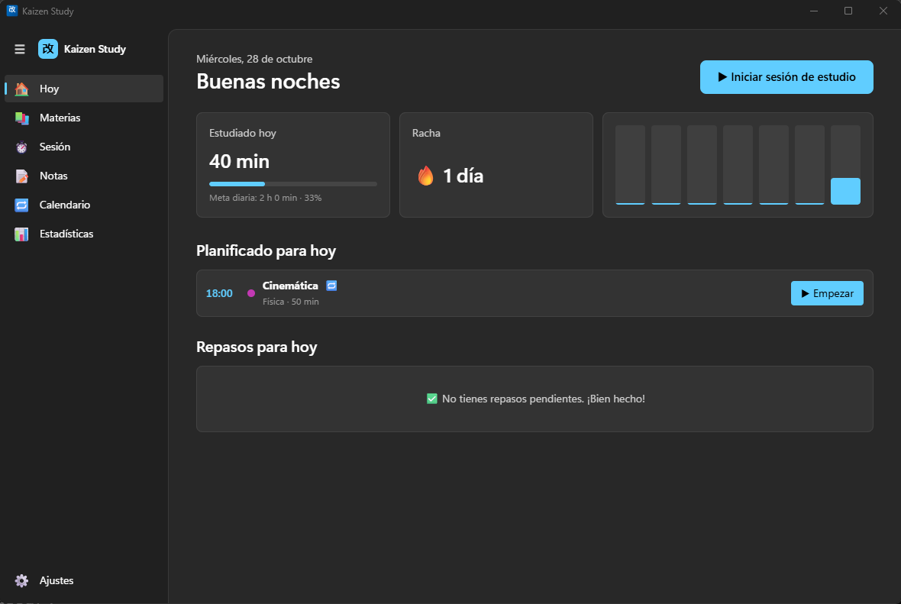
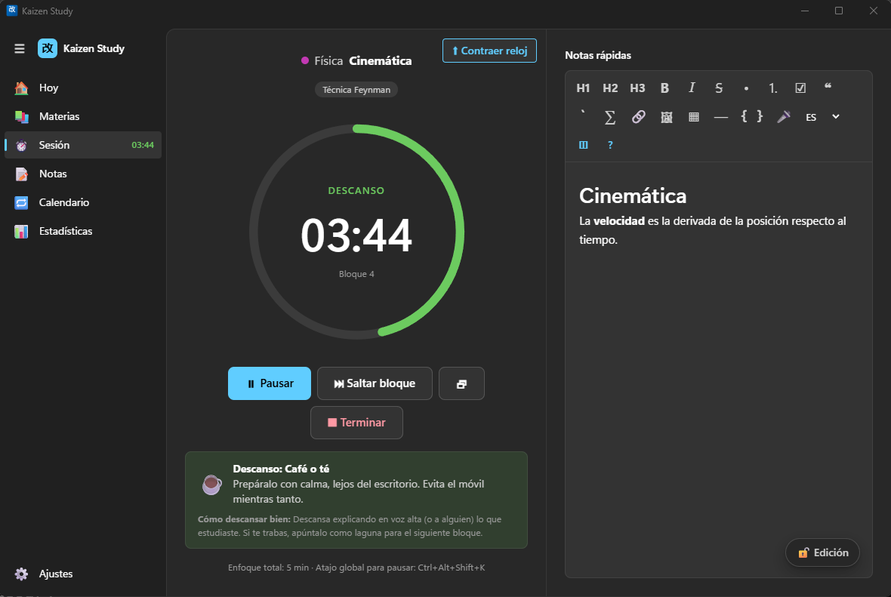
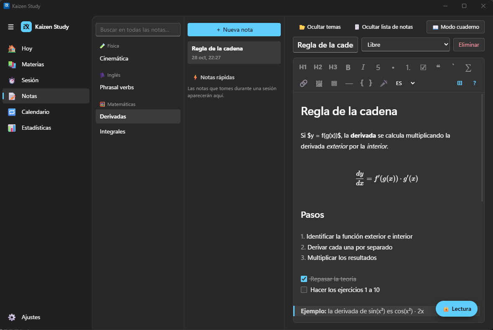
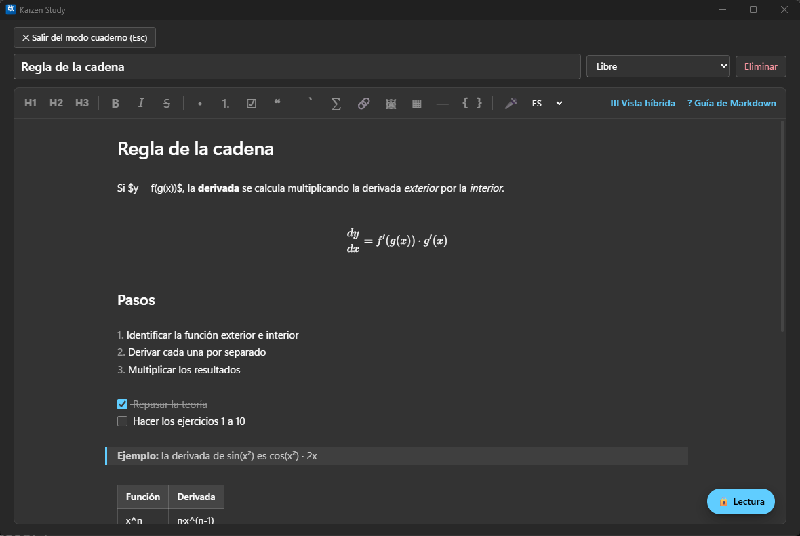
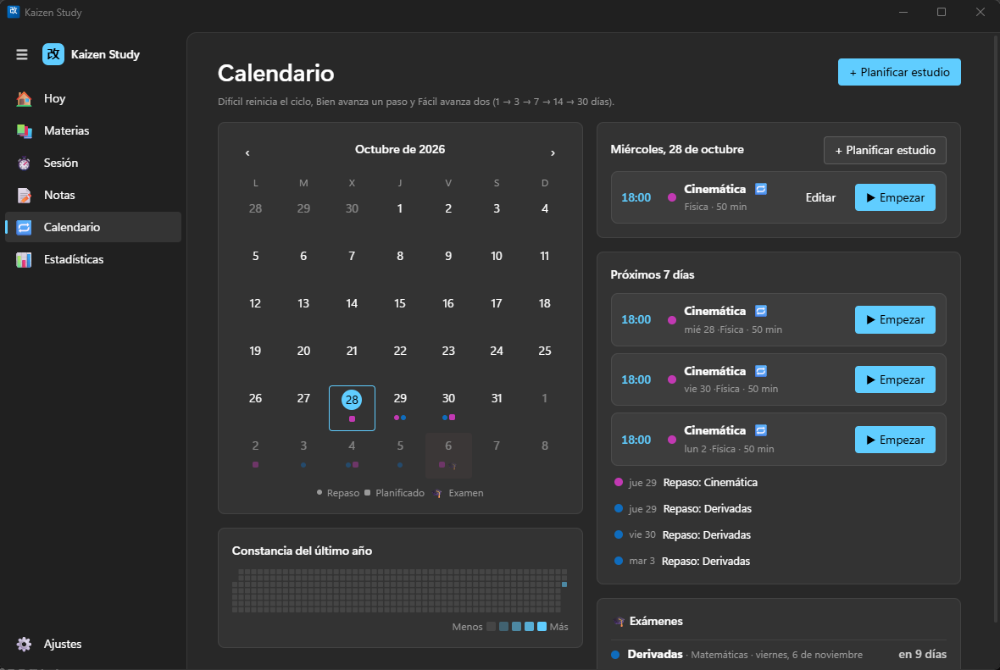

# Kaizen Study

Organizador de sesiones de estudio para Windows: temporizadores con métodos probados,
notas en Markdown, repasos espaciados y estadísticas. 100 % local, sin cuentas ni nube.

**[⬇ Descargar el instalador para Windows](https://github.com/AndrewQuest/kaizen-study/releases/latest)**

## Capturas

| Hoy | Sesión de estudio |
|---|---|
|  |  |

| Notas (editor híbrido con LaTeX y código) | Modo cuaderno |
|---|---|
|  |  |

**Calendario: estudios planificados, repasos y exámenes**



## Stack

| Capa | Tecnología |
|---|---|
| Escritorio | Tauri 2 (WebView2) |
| Backend | Rust · SQLite (`rusqlite`) |
| Interfaz | Svelte 5 + TypeScript (SvelteKit en modo SPA) |
| Editor | CodeMirror 6 con vista híbrida (live preview) |

## Desarrollo

Requisitos: Node 20+, Rust stable, Visual Studio Build Tools (C++), y para el dictado
(whisper.cpp) **CMake** y **LLVM**: `winget install Kitware.CMake LLVM.LLVM`
(las rutas están en `src-tauri/.cargo/config.toml`).

```powershell
npm install
npm run tauri dev        # app en modo desarrollo
npm run check            # tipos de Svelte/TypeScript
cd src-tauri; cargo test # pruebas de la lógica (repasos, rachas, respaldo…)
```

## Pruebas de extremo a extremo

Abren el ejecutable real con datos temporales y un reloj 60× más rápido, y recorren la app
completa (materias, sesión, notas, guía, repasos, respaldo, recuperación tras cierre forzado…).

```powershell
npx tauri build --no-bundle   # compila el .exe
npm run e2e                   # cierra antes cualquier Kaizen Study abierto
```

Las capturas quedan en `e2e/screens/`.

Revisión visual (capturas reales de todas las pantallas vacías, al 100 % y al 150 %, y
detector de desbordes horizontales):

```powershell
npm run review            # capturas en e2e/screens/review
```

Pruebas manuales del dictado (necesitan un modelo descargado):

```powershell
$env:KAIZEN_TOOLS_DIR = "<carpeta con whisper\ggml-tiny.bin>"
$env:KAIZEN_TEST_WAV  = "<grabación de voz .wav>"
cd src-tauri; cargo test --release -- --ignored   # transcripción + captura de cada micrófono
```

## Instaladores

```powershell
npm run tauri build
```

Genera `src-tauri/target/release/bundle/nsis/*-setup.exe` y `bundle/msi/*.msi`.

## Estructura

```
src/                     Interfaz (Svelte)
  lib/views/             Pantallas: Hoy, Materias, Sesión, Notas, Repasos, Estadísticas, Ajustes
  lib/components/        Diálogos, editor Markdown, guía, gráfica…
  lib/editor/            Editor híbrido: vista previa en vivo, comandos, tema estilo VS Code
  lib/i18n/es.json       Todos los textos (para añadir idiomas: crear xx.json)
  lib/templates.ts       Plantillas de métodos de estudio
  lib/render.ts          Markdown → HTML único (vista dividida; base para exportar/imprimir)
src-tauri/src/           Rust
  db.rs                  Esquema SQLite, migraciones y consultas
  timer.rs               Temporizador (hilo propio, preciso aunque la ventana esté oculta)
  storage.rs             Carpeta de datos y respaldos .kaizen
  tray.rs                Icono de bandeja
  notify.rs              Notificaciones al teléfono (ntfy, Telegram, correo) y recordatorios
  spell.rs               Corrector ortográfico (Hunspell vía spellbook)
  media.rs               Adjuntos (carpeta «adjuntos») y títulos de páginas web
  latex.rs               Documentos LaTeX con Tectonic (descarga opcional)
  dictation.rs           Dictado local con whisper.cpp (micrófono vía cpal)
  links.rs               Enlaces: abrir en el navegador y bloquear navegación externa
  commands.rs            Comandos expuestos a la interfaz
src-tauri/dictionaries/  Diccionarios Hunspell es/en (licencias en LICENSE-es / LICENSE-en)
e2e/app.e2e.mjs          Prueba de extremo a extremo
```

## Variables de entorno (solo para pruebas)

| Variable | Efecto |
|---|---|
| `KAIZEN_CONFIG_DIR` | Carpeta alternativa para `config.json` |
| `KAIZEN_TIME_SCALE` | Acelera el reloj (p. ej. `60` = 1 minuto por segundo) |
| `KAIZEN_TOOLS_DIR` | Carpeta alternativa para Tectonic y modelos de Whisper |
| `KAIZEN_OPEN_LOG` | Registra en ese archivo los enlaces que se abrirían (no abre el navegador) |

Con `KAIZEN_CONFIG_DIR` definido la app no aplica «una sola instancia», así que las pruebas
pueden correr con tu Kaizen Study abierto.

La prueba e2e levanta un servidor ntfy local para verificar las notificaciones al teléfono y
el planificador de recordatorios; Telegram y correo requieren cuentas reales y se prueban
desde Ajustes → «Enviar prueba».
